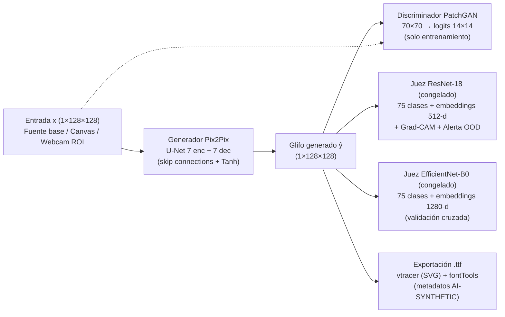

# Handwritten Font cGAN — Generación de Tipografía Manuscrita

Sistema *end-to-end* de traducción imagen-a-imagen condicional (**Pix2Pix: U-Net + PatchGAN**) para sintetizar glifos manuscritos (`1×128×128`), auditar su legibilidad en tiempo real mediante dos clasificadores CNN congelados (`ResNet-18` y `EfficientNet-B0`), ejecutar inferencia en CPU a **47.45 FPS (`21.07 ms`)** con **ONNX Runtime** y exportar tipografías instalables en formato **`.ttf`** (`vtracer` + `fontTools`).

---

## 1. Problema y Usuario

- **Problema:** Digitalizar escritura manuscrita personal en una tipografía instalable (`.ttf`) suele exigir el trazado vectorial manual de decenas de glifos en software especializado (FontForge, Glyphs). Por otro lado, los modelos generativos basados en difusión demandan GPUs dedicadas y latencias de segundos por carácter, impidiendo una previsualización interactiva en tiempo real sobre hardware estándar.
- **Usuario objetivo:** Diseñadores gráficos, ilustradores, docentes, creadores de contenido y desarrolladores que buscan capturar una muestra compacta de caligrafía propia (~300 trazos mediante stylus o plantilla), previsualizar glifos en tiempo real por teclado, dibujo libre o cámara web, y compilar una fuente `.ttf` lista para instalar.
- **Solución técnica:**
  - **Generador condicional (`Pix2Pix`):** U-Net de 7 niveles con *skip connections* + discriminador PatchGAN (`70×70`), preentrenado sobre **3,825 pares sintéticos** de 17 fuentes manuscritas abiertas (*Transfer Learning*) y evaluado frente a *fine-tuning* (`--mode finetune`) y entrenamiento desde cero (`--mode scratch`) sobre **300 trazos manuscritos reales con stylus**.
  - **Auditoría automatizada y detección OOD:** Dos redes clasificadoras independientes (`ResNet-18` y `EfficientNet-B0`) congeladas proveen métricas objetivas de legibilidad (**Accuracy, Macro-F1, FID de dominio**), explicabilidad espacial (**Grad-CAM**) y rechazo de entradas fuera de distribución (**OOD**).
  - **Despliegue ligero:** Exportación a **ONNX Runtime** (**21.07 ms / 47.45 FPS** para `G + ResNet-18` en CPU, speedup **1.69×** vs. PyTorch) acoplada a una demo OpenCV en tiempo real y un pipeline de vectorización hacia `.ttf` con metadatos de trazabilidad incrustados.

---

## 2. Integrantes

Proyecto desarrollado de forma **individual** para la materia *Deep Learning para Visión de Computadoras* (CUGDL — Universidad de Guadalajara):

| Nombre completo | Código de alumno | Rol |
| :--- | :---: | :--- |
| **Carlo A. Amezcua L.** | `[PENDIENTE: insertar código UdeG]` | Desarrollo integral: diseño de datos, captura manuscrita, entrenamiento GPU, evaluación, interpretabilidad, despliegue ONNX y documentación |

---

## 3. Conjunto de Datos

El diseño completo, licencias, revisión manual de calidad (sintética y real) y auditoría anti-fuga están documentados en [`docs/datasheet.md`](docs/datasheet.md) y explorados en [`notebooks/01_eda_datos.ipynb`](notebooks/01_eda_datos.ipynb):

- **Vocabulario unificado (`src/config.py`):** **75 símbolos** divididos en 4 subgrupos — Mayúsculas (`A–Z`, 26), Minúsculas (`a–z`, 26), Dígitos (`0–9`, 10) y Signos básicos (`.,!?()+-=/:;&`, 13) — en resolución `1×128×128` (escala de grises, fondo blanco `255`, trazo negro `0`, normalizado a `[-1, 1]`).
- **Dataset sintético (`data/synthetic_pairs/`):** **3,825 pares `(x, y)`** generados de forma determinista (`SEED = 42`) emparejando `Lato-Regular` con **17 Google Fonts manuscritas** bajo licencia **SIL Open Font License 1.1 (OFL)**.
- **Dataset personal real (`data/real_pairs/`):** **300 muestras manuscritas propias** (75 símbolos × 4 repeticiones, extracción 300/300 sin celdas vacías) capturadas con stylus mediante la interfaz web guiada (`src/data/captura_stylus.py` + `src/data/stylus_web_ui.py`) y normalizadas con OpenCV (`src/data/02_extraer_recortes.py`).
- **Evaluación Fuera de Distribución (`data/ood/` y `src/data/capturar_ood_real.py`):** **72 imágenes** en 6 categorías OOD (ruido puro, garabatos, símbolos inéditos `@ # $ % ñ Ñ ¿ ¡ *`, rotación extrema ±45°, desenfoque/corte y sombra/bajo contraste) más utilidad de captura de muestras reales en cámara web (`capturar_ood_real.py`).
- **Particiones estrictas sin fuga de información (verificadas en `src/data/` y `notebooks/01_eda_datos.ipynb`):**
  - **Prueba Zero-Shot (`test_unseen/`):** 11 símbolos reservados (`G, Q, k, z, 4, 8, ?, &, +, ;, )`) viven exclusivamente en `test_unseen/` (`set(train) ∩ set(test_unseen) == ∅`). **Nunca se usan para entrenar el generador, elegir hiperparámetros ni seleccionar checkpoints.**
  - **Separación por fuente y por repetición:** En el dataset sintético se particiona por **fuente tipográfica completa** (`14` fuentes en `train` = 2,688 pares; `3` fuentes inéditas en `val` = 576 pares; `test_unseen` = 561 pares). En `real_pairs`, las 4 repeticiones por símbolo visto se separan en `3` para `train` (192) y `1` para `val` (64), dejando las 4 repeticiones de los 11 símbolos inéditos en `test_unseen` (44).
  - **Aumentos invariantes a semántica:** Transformaciones afines suaves solo en `train` (`±4°`, `±4 %` traslación, `0.94–1.06` escala); se prohíben explícitamente volteos horizontales/verticales (`b ↔ d`, `p ↔ q`, `6 ↔ 9`).
- **Descarga de pesos y datos reales:** Los binarios pesados no se versionan en Git (ver `.gitignore` y [`data/README.md`](data/README.md)). Pueden descargarse directamente desde los **GitHub Releases** del proyecto (`v1.0-final`) con:
  ```bash
  python -m src.data.download_artifacts --all
  ```

---

## 4. Arquitectura y Justificación



### Decisiones arquitectónicas (con evidencia experimental propia)

| Comparativa / Alternativa | Tipo de evidencia | Hallazgo y decisión adoptada |
| :--- | :---: | :--- |
| **`Pix2Pix` vs. `StyleUNet` (Style Encoder + AdaIN)** | **Experimento propio** (`03_colab_finetuning.ipynb` vs. `04_colab_style_encoder.ipynb`) | Al desacoplar contenido (`x`) y estilo (`4` glifos de referencia en `StyleEncoder` sin `InstanceNorm` + `AdaIN` + aumento morfológico de grosor), `StyleUNet` superó a todas las variantes de Pix2Pix sobre `real_pairs`: igualó el techo humano en `val` (**89.06 % Acc / 85.94 % Macro-F1**) y disparó Zero-Shot (`test_unseen`) de `9.09–27.27 %` a **72.73 %** (+45.5 pp sobre `pretrained`, FID `499.83 → 302.42`). |
| **`Pix2Pix Pretrain` vs. `Scratch` vs. `Fine-Tune` sobre `real_pairs`** | **Experimento propio** (`03_colab_finetuning.ipynb`) | Sin *Style Encoder*, en dominio propio (`val`, 64 clases) `scratch` alcanzó **75.00 % Acc / FID 94.87** superando a `pretrained` (71.88 %) y `finetune` (62.50 %) por choque de grosor de trazo, pero ambos degradaron en `test_unseen` (Zero-Shot), lo que motivó directamente el diseño aditivo de `StyleUNet`. |
| **Juez `ResNet-18` vs. `EfficientNet-B0`** | **Experimento propio** (`02_colab_training.ipynb`, `robustez.ipynb`) | `ResNet-18` superó a `EfficientNet-B0` tanto en validación sintética (`87.67 %` vs. `85.07 %` Acc) como en separación OOD (**AUROC 0.9435** vs. `0.8856`) y latencia CPU (**4.69 ms** en ONNX). Se eligió `ResNet-18` para la demo en tiempo real y `EfficientNet-B0` como segundo juez independiente de validación cruzada. |
| **PyTorch CPU vs. ONNX Runtime CPU** | **Experimento propio** (`export_onnx.py`) | Exportar `G + ResNet-18` a ONNX con `intra_op_num_threads=4` redujo la latencia del pipeline de **35.61 ms (28.08 FPS)** a **21.07 ms (47.45 FPS)** (**1.69× speedup**, error máx. `< 1e-5`). |
| **Descarte de Diffusion / ControlNet y CycleGAN** | Análisis de costo y restricciones | Los modelos de difusión exigen GPU dedicada (>6 GB VRAM) y segundos por glifo (`<1 FPS` en CPU), rompiendo el requisito de tiempo real (`≥10 FPS`). CycleGAN opera sin pares alineados ni pérdida `L1`, deformando topologías de caracteres inéditos; al disponer de pares exactos `(Lato, manuscrito)`, las *skip connections* + `L1 (λ=100)` preservan la estructura base. |

---

## 5. Resultados Principales

### 5.1 Evaluación cuantitativa (`eval/evaluate_models.py`)

#### A) Dominio sintético multi-fuente (`data/synthetic_pairs/`, `pix2pix_pretrained.pth`)

| Split | Modelo / Fuente | Accuracy (`ResNet-18` / `EffNet-B0`) | Macro-F1 (`ResNet-18` / `EffNet-B0`) | L1 media | FID dominio (`ResNet-18`) |
| :--- | :--- | :---: | :---: | :---: | :---: |
| `val` (64 vistas, 3 fuentes inéditas) | Referencia `y` (techo) | 87.67 % / 85.07 % | 87.58 % / 85.30 % | — | 0.00 |
| `val` (64 vistas) | `pix2pix_pretrained` | 71.88 % / 68.75 % | 67.45 % / 64.58 % | 0.1104 | 133.24 |
| `test_unseen` (11 Zero-Shot)* | Referencia `y` (techo global)* | 98.22 % / 97.68 % | 98.99 % / 98.61 % | — | 0.00 |
| `test_unseen` (11 Zero-Shot) | `pix2pix_pretrained` | 45.45 % / 54.55 % | 45.45 % / 50.00 % | 0.0994 | 358.22 |

> \* **Nota de transparencia metodológica sobre el techo `reference_y` en `test_unseen` sintético:** para poder clasificar símbolos Zero-Shot, los jueces CNN se entrenaron sobre las 75 clases divididas por fuente (`judge_split`: 14 fuentes en `train`, 3 en `val`). Por ello, 462 de los 561 pares de `synthetic_pairs/test_unseen` pertenecen a `judge_split=train` (100.00 % Acc del juez), mientras que el subconjunto sin traslape de fuente (`judge_split=val`, `n=99`) obtiene **89.90 % Acc** — consistente con `val` (87.67 %) y con `real_pairs/test_unseen` (86.36 %, 0 % de traslape con el entrenamiento de los jueces). El generador Pix2Pix **nunca** vio ninguno de los 11 caracteres de `test_unseen`.

#### B) Dominio personal real con stylus (`data/real_pairs/`, 300 muestras — `03_colab_finetuning.ipynb` y `04_colab_style_encoder.ipynb`)

| Split | Modelo / Fuente | Accuracy (`ResNet-18` / `EffNet-B0`) | Macro-F1 (`ResNet-18` / `EffNet-B0`) | L1 media | FID dominio (`ResNet-18`) |
| :--- | :--- | :---: | :---: | :---: | :---: |
| `val` (64 vistas) | Referencia `y` (techo stylus real) | 89.06 % / 84.38 % | 86.20 % / 81.25 % | — | 0.00 |
| `val` (64 vistas) | `pix2pix_pretrained` | 71.88 % / 71.88 % | 67.45 % / 67.97 % | 0.0947 | 145.25 |
| `val` (64 vistas) | `pix2pix_scratch` | 75.00 % / 67.19 % | 69.27 % / 59.64 % | 0.0570 | **94.87** |
| `val` (64 vistas) | `pix2pix_finetuned` (`100 ep, lr=1e-4`) | 62.50 % / 56.25 % | 56.38 % / 47.50 % | 0.0550 | 121.14 |
| `val` (64 vistas) | `style_unet_fewshot` *(0 ep. fine-tuning, 4 refs)* | 84.38 % / 73.44 % | 80.99 % / 69.79 % | 0.0639 | 141.47 |
| `val` (64 vistas) | **`style_unet_finetuned`** *(mejor ep. 4, StyleEnc congelado)* | **89.06 %** / **79.69 %** | **85.94 %** / **74.95 %** | 0.0646 | 126.18 |
| `test_unseen` (11 Zero-Shot, `n=44`) | Referencia `y` (techo stylus real) | 86.36 % / 81.82 % | 85.28 % / 78.79 % | — | 0.00 |
| `test_unseen` (11 Zero-Shot) | `pix2pix_pretrained` | 27.27 % / 45.45 % | 27.27 % / 42.42 % | 0.0981 | 407.37 |
| `test_unseen` (11 Zero-Shot) | `pix2pix_scratch` | 27.27 % / 9.09 % | 27.27 % / 3.03 % | 0.0691 | 469.96 |
| `test_unseen` (11 Zero-Shot) | `pix2pix_finetuned` (`100 ep, lr=1e-4`) | 9.09 % / 27.27 % | 9.09 % / 21.82 % | 0.0667 | 499.83 |
| `test_unseen` (11 Zero-Shot) | `style_unet_fewshot` *(0 ep. fine-tuning, 4 refs)* | 54.55 % / **45.45 %** | 54.55 % / **42.42 %** | 0.0676 | 307.42 |
| `test_unseen` (11 Zero-Shot) | **`style_unet_finetuned`** *(mejor ep. 4, StyleEnc congelado)* | **72.73 %** / **45.45 %** | **72.73 %** / **42.42 %** | 0.0728 | **302.42** |

> **Nota estadística y visual:** `test_unseen` contiene exactamente **11 clases** (~9.09 pp por clase). Incluso sin *fine-tuning*, `style_unet_fewshot` ya supera ampliamente a todas las variantes de Pix2Pix tanto en vistas (`84.38 %`) como en Zero-Shot (`54.55 %`), y `style_unet_finetuned` alcanza el techo humano en `val` (`89.06 %`) y **`72.73 %` en Zero-Shot** (ver [`style_eval_style_real_val.png`](docs/figuras/style_eval_style_real_val.png) y [`style_eval_style_real_test_unseen.png`](docs/figuras/style_eval_style_real_test_unseen.png)). Las curvas de entrenamiento y control de sobreajuste están en [`train_judge_resnet18.png`](docs/figuras/train_judge_resnet18.png), [`train_judge_efficientnet_b0.png`](docs/figuras/train_judge_efficientnet_b0.png), [`train_pix2pix_pretrain.png`](docs/figuras/train_pix2pix_pretrain.png), [`train_pix2pix_scratch.png`](docs/figuras/train_pix2pix_scratch.png), [`train_pix2pix_finetune.png`](docs/figuras/train_pix2pix_finetune.png), [`train_style_unet_pretrain.png`](docs/figuras/train_style_unet_pretrain.png) y [`train_style_unet_finetune.png`](docs/figuras/train_style_unet_finetune.png).

### 5.2 Rendimiento en tiempo real con ONNX Runtime (`docs/robustez_y_despliegue.md`)

Medido en **CPU Intel (Intel64 Family 6 Model 186 Stepping 2, 12 núcleos lógicos)**, Windows 10, sin GPU dedicada, Python `3.11.18`, PyTorch `2.15.0+cpu`, ONNX Runtime `1.32.0` (`intra_op_num_threads=4`, `batch_size = 1`, `1×128×128`, 100 inferencias tras 10 de calentamiento):

| Etapa | PyTorch CPU (ms) | ONNX Runtime CPU (ms) | ONNX p95 (ms) | ONNX FPS | Speedup | Tiempo real (≥10 FPS) |
| :--- | :---: | :---: | :---: | :---: | :---: | :---: |
| Generador `G` (`UNetGenerator`) | 29.14 ± 3.99 | **16.86 ± 2.29** | 20.70 | **59.30** | **1.73×** | Sí |
| Juez (`ResNet-18`) | 8.47 ± 0.92 | **4.69 ± 0.78** | 5.88 | **213.22** | **1.81×** | Sí |
| **Pipeline completo (`G + Juez`)** | 35.61 ± 3.87 | **21.07 ± 1.83** | **24.00** | **47.45** | **1.69×** | **Sí (≤100 ms)** |

### 5.3 Robustez OOD, Interpretabilidad y Auditoría por Subgrupos
- **Detección OOD (`eval/robustez.ipynb`, 72 imágenes en 6 categorías):** `ResNet-18` alcanza **AUROC = 0.9435** en evaluación directa (`94.4 %` rechazo en `τ = 0.85`). En el pipeline de la demo (`G + ResNet-18`, `τ = 0.70`) rechaza **81.9 %** global (**100 %** en `garabatos` y `simbolos_ineditos`, **91.7 %** en `ruido_puro` y `rotacion_extrema`).
- **Interpretabilidad (`docs/interpretabilidad.md`):** Los mapas Grad-CAM sobre `ResNet-18` y `EfficientNet-B0` obtienen una similitud coseno espacial de **0.9895** entre `Grad-CAM(y)` y `Grad-CAM(ŷ)` en aciertos Zero-Shot (vs. **0.9257** en errores), explicando causalmente 6 fallos agrupados en 4 causas físicas (`! → l`, `i → l`, `6 → C`, `: → ;`, `l → I`, `4/Q/G` Zero-Shot).
- **Auditoría por subgrupos (`eval/auditoria_subgrupos.ipynb`):** Desglose de Macro-F1 por `Mayúsculas` (77.8 %), `Minúsculas`, `Dígitos` y `Signos` (45.8 %, brecha de 31.95 pp motivando énfasis en trazos finos).

---

## 6. Instalación y Reproducción (≤ 5 comandos)

Requisitos: **Python 3.11** (semilla determinista global `SEED = 42` en `src/config.py` y `src/utils.py`; dependencias exactas fijadas en `requirements.txt`).

```bash
# 1. Clonar el repositorio
git clone https://github.com/carloamezcua/handwritten-font-cgan.git && cd handwritten-font-cgan

# 2. Crear entorno virtual e instalar dependencias fijadas (agregar --extra-index-url https://download.pytorch.org/whl/cpu si es solo CPU)
python -m venv .venv && .venv/Scripts/pip install --extra-index-url https://download.pytorch.org/whl/cpu -r requirements.txt

# 3. Regenerar dataset sintético (3,825 pares) y set OOD (72 imágenes) de forma determinista
.venv/Scripts/python -m src.data.03_generar_sinteticos --download-fonts && .venv/Scripts/python -m src.data.04_generar_ood

# 4. Descargar checkpoints entrenados + capturas reales (o entrenar desde cero en GPU con notebooks/02 y 03)
.venv/Scripts/python -m src.data.download_artifacts --all

# 5. Exportar/validar ONNX, compilar fuentes .ttf y correr evaluación + Grad-CAM
.venv/Scripts/python -m src.export.export_onnx && .venv/Scripts/python -m src.export.build_ttf && .venv/Scripts/python -m eval.evaluate_models && .venv/Scripts/python -m eval.gradcam_analysis
```

> Para re-entrenar los modelos desde cero localmente o en Google Colab T4: ejecuta `python -m src.train.train_judges --model all --pretrained`, `python -m src.train.train_pix2pix --mode pretrain`, y [`notebooks/03_colab_finetuning.ipynb`](notebooks/03_colab_finetuning.ipynb) para `scratch` y `finetune` sobre `data/real_pairs/`.

---

## 7. Cómo Correr la Demo en Tiempo Real

```bash
python app/demo_realtime.py
```

> **Modelo activo en la demo:** `checkpoints/generator.onnx` (exportado desde `pix2pix_pretrained.pth`) + `checkpoints/judge_resnet18.onnx`. Se emplea el generador preentrenado como valor por defecto porque conserva la mejor legibilidad *Zero-Shot* cuando el usuario escribe cualquier carácter o dibuja libremente en vivo; cualquier variante entrenada (`scratch` o `finetune`) puede cargarse con `--generator-onnx`.

**Controles en vivo (verificados en [`app/demo_realtime.py`](app/demo_realtime.py)):**
- **Teclado (`A–Z`, `a–z`, `0–9`, signos):** renderiza el carácter correspondiente en el Canvas.
- **Mouse (clic izquierdo arrastrado):** dibujo libre sobre el panel izquierdo en modo Canvas.
- **`Tab`** (o **`M`** en modo Webcam / dibujo libre): alterna entre **Canvas interactivo** y **Webcam ROI** (flujo continuo con centrado automático por *bounding box*).
- **`F`** (en modo Webcam): activa/desactiva espejo horizontal.
- **`+` / `-`** (o `=` / `_`): ajusta en vivo el umbral de confianza OOD en pasos de `±0.05` (rango `0.10–0.95`, default `0.70`), alternando el indicador visual entre `OK (CONFIABLE)` y `BAJA CONFIANZA (OOD)`.
- **`Space`:** avanza al siguiente símbolo del vocabulario (`CHARSET`).
- **`Backspace`:** limpia el lienzo del Canvas.
- **`Ctrl+S`:** guarda captura de la ventana en `results/demo_capture.png`.
- **`ESC`:** sale limpiamente liberando la cámara web.

---

## 8. Video de Respaldo

- **Enlace al video de respaldo (1–2 min, demo en vivo + exportación `.ttf`):** `[PENDIENTE: insertar enlace a YouTube Unlisted / Google Drive público antes del tag v1.0-final]`
- **Contenido del respaldo:** arranque de `python app/demo_realtime.py` en CPU mostrando FPS en pantalla (`>40 FPS`), síntesis en vivo en modo Canvas (caracteres vistos y Zero-Shot), dibujo libre, detección `BAJA CONFIANZA (OOD)` ajustando el umbral con `+`/`-`, modo Webcam ROI con letra escrita en papel y vista previa de la fuente `.ttf` compilada.

---

## 9. Limitaciones

Resumen técnico y ético (detalle completo en [`MODEL_CARD.md`](MODEL_CARD.md), [`docs/informe_etico.pdf`](docs/informe_etico.pdf) y [`docs/interpretabilidad.md`](docs/interpretabilidad.md)):

1. **Glifos aislados (`1×128×128`):** Sintetiza caracteres individuales sin modelar ligaduras cursivas continuas ni dinámica de presión entre letras adyacentes.
2. **Choque de dominio en *fine-tuning* con trazos finos:** El trazo personal con stylus (~2.57 % de píxeles activos) es mucho más delgado que el promedio de las 17 fuentes sintéticas, haciendo que `scratch` supere a `finetune` en caracteres vistos pero que ambos pierdan capacidad Zero-Shot frente a `pretrained` (límite de Pix2Pix sin *encoder* de estilo desacoplado).
3. **Sensibilidad en trazos pequeños y pares ambiguos:** Puntos aislados (`!`, `i`, `:`) y caracteres *sans-serif* similares (`l/I/1`, `0/O/o`, `0` tachado) concentran la mayoría de confusiones.
4. **Tamaño de muestra Zero-Shot (`n = 11` clases):** Cada clase en `test_unseen` pesa ~9.09 pp en Accuracy, por lo que diferencias pequeñas en `test_unseen` real tienen alta varianza estadística.
5. **Cobertura de alfabeto base:** Entrenado sobre 75 caracteres ASCII; glifos extendidos del español (`ñ, Ñ, ¿, ¡`) se generan de forma experimental solo en inferencia.
6. **Uso responsable:** Prohibido su uso para suplantación de identidad o falsificación de firmas/documentos sin consentimiento explícito. Como salvaguarda concreta, [`src/export/build_ttf.py`](src/export/build_ttf.py) incrusta marcadores de origen (`AI-SYNTHETIC` / `PERSONAL-STYLUS`, copyright, descripción y licencia) directamente en la tabla OpenType `name` de cada `.ttf` compilado.

---

## 10. Uso de IA Generativa y Créditos

### Declaración de uso de IA generativa
En cumplimiento con la política de transparencia de la asignatura, se declara el uso de asistentes de IA generativa (**Antigravity / Gemini / Claude**) como herramienta de apoyo durante el desarrollo para:
- Estructuración inicial y refactorización de scripts de entrenamiento, exportación ONNX/TTF y utilidades OpenCV (`src/`, `app/`, `eval/`).
- Auditoría de calidad contra la rúbrica, optimización de hilos en ONNX Runtime y revisión de redacción en la documentación técnica (`README.md`, `MODEL_CARD.md`, `docs/`).

El planteamiento del problema, la selección y validación de datasets, la captura manual de las **300 muestras manuscritas con stylus**, la ejecución y ajuste de experimentos en Google Colab GPU (`notebooks/02` y `03`), la inspección visual de errores y la verificación de la aplicación en vivo fueron realizados y validados directamente por el autor.

### Documentación del repositorio

| Documento | Contenido |
| :--- | :--- |
| [`MODEL_CARD.md`](MODEL_CARD.md) | Alcance del modelo, usos previstos/no previstos, sesgos y mitigaciones |
| [`docs/datasheet.md`](docs/datasheet.md) | Origen de datos, licencias OFL, protocolo anti-fuga y auditoría manual |
| [`docs/caso_sector.pdf`](docs/caso_sector.pdf) | Caso de uso sectorial, propuesta de valor y análisis de usuarios |
| [`docs/informe_etico.pdf`](docs/informe_etico.pdf) | Análisis de riesgos éticos, sesgos, privacidad y salvaguardas |
| [`docs/interpretabilidad.md`](docs/interpretabilidad.md) | Análisis espacial con Grad-CAM y diagnóstico causal de errores |
| [`docs/robustez_y_despliegue.md`](docs/robustez_y_despliegue.md) | Benchmarks PyTorch vs. ONNX Runtime y evaluación de rechazo OOD |
| [`docs/costos.md`](docs/costos.md) | Costos medidos de entrenamiento GPU, inferencia CPU y almacenamiento |
| [`docs/defensa.pdf`](docs/defensa.pdf) | Presentación ejecutiva para la defensa técnica (12 min) |
| [`eval/robustez.ipynb`](eval/robustez.ipynb) | Evaluación cuantitativa y visual de 72 imágenes OOD |
| [`eval/auditoria_subgrupos.ipynb`](eval/auditoria_subgrupos.ipynb) | Desempeño desglosado por subgrupo tipográfico (`A–Z`, `a–z`, `0–9`, signos) |
| [`notebooks/01_eda_datos.ipynb`](notebooks/01_eda_datos.ipynb) | Análisis exploratorio de datos, balance de clases e inspección visual |
| [`notebooks/02_colab_training.ipynb`](notebooks/02_colab_training.ipynb) | Entrenamiento reproducible de jueces y Pix2Pix pretrain en Colab T4 |
| [`notebooks/03_colab_finetuning.ipynb`](notebooks/03_colab_finetuning.ipynb) | Experimentos de personalización Pix2Pix (`pretrained` vs. `scratch` vs. `finetune`) |
| [`notebooks/04_colab_style_encoder.ipynb`](notebooks/04_colab_style_encoder.ipynb) | Experimento aditivo `StyleUNet` (Style Encoder + AdaIN) Few-Shot y Fine-Tune |

### Referencias y créditos
- **Autor:** Carlo A. Amezcua L.
- **Literatura base:**
  - Isola et al. (2017), *"Image-to-Image Translation with Conditional Adversarial Networks"* (CVPR — Pix2Pix).
  - Selvaraju et al. (2017), *"Grad-CAM: Visual Explanations from Deep Networks via Gradient-based Localization"* (ICCV).
  - Mitchell et al. (2019), *"Model Cards for Model Reporting"* (FAT*); Gebru et al. (2021), *"Datasheets for Datasets"* (CACM).
- **Fuentes y bibliotecas:** **Google Fonts** bajo licencia **SIL Open Font License 1.1** (`data/fonts/licenses.csv`), PyTorch, Torchvision, OpenCV, ONNX Runtime, scikit-learn, SciPy, `vtracer` y `fontTools`.
