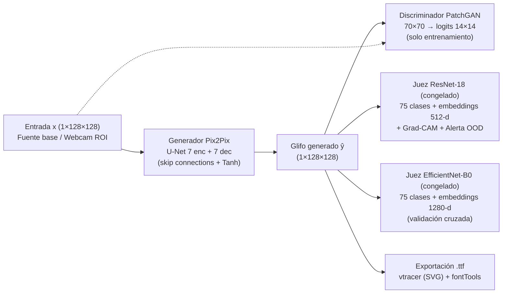

# Generación de Tipografía Manuscrita con Image-to-Image cGAN

Proyecto final de **Deep Learning para Visión de Computadoras (2026B — Licenciatura en Inteligencia Artificial y Ciencia de Datos, CUGDL — Universidad de Guadalajara)**.

---

## 1. Problema y Usuario

- **Problema:** Digitalizar la escritura manuscrita personal en una tipografía instalable (`.ttf`) normalmente requiere dibujar manualmente decenas o cientos de glifos en software vectorial especializado, un proceso lento y costoso. Además, los modelos generativos pesados basados en difusión resultan demasiado lentos para operar en tiempo real sobre una PC estándar sin GPU dedicada.
- **Usuario objetivo:** Estudiantes, diseñadores, ilustradores, docentes y creadores de contenido que desean capturar una muestra reducida de su propia caligrafía (~300 trazos), previsualizar la síntesis de caracteres en tiempo real (por teclado o cámara web) y exportar una tipografía `.ttf` lista para usar.
- **Solución:** Un sistema completo de visión por computadora basado en una **cGAN condicional (Pix2Pix: U-Net + PatchGAN)** con **preentrenamiento sintético (*Transfer Learning*)** sobre fuentes manuscritas abiertas y *fine-tuning* sobre trazos propios del autor, auditado con dos clasificadores CNN congelados (`ResNet-18` y `EfficientNet-B0`), optimizado a **ONNX** para correr a **≥10 FPS en CPU** y acoplado a un pipeline de vectorización (`vtracer` + `fontTools`) hacia `.ttf`.

---

## 2. Integrantes

| Nombre completo | Código de estudiante | Rol principal |
| :--- | :---: | :--- |
| **Carlo A. Amezcua L.** | `[COMPLETAR CÓDIGO]` | Arquitectura Pix2Pix/Jueces, pipeline OpenCV/Stylus, despliegue ONNX, demo tiempo real y evaluación |

> *(Si el proyecto es en equipo, agrega aquí el nombre completo y código de cada integrante y verifica que todos tengan commits técnicos propios en GitHub — Rúbrica A3).*

---

## 3. Conjunto de Datos

Resumen del diseño de datos (ver documentación completa, licencias y revisión manual en el **[Datasheet (`docs/datasheet.md`)](docs/datasheet.md)** y análisis exploratorio en **[`notebooks/01_eda_datos.ipynb`](notebooks/01_eda_datos.ipynb)**):

- **Vocabulario único (`src/config.py`):** **75 símbolos** divididos en 4 subgrupos — Mayúsculas (`A–Z`, 26), Minúsculas (`a–z`, 26), Dígitos (`0–9`, 10) y Signos básicos (`.,!?()+-=/:;&`, 13) — todos con resolución uniforme `1×128×128` (escala de grises, fondo blanco `255`, trazo negro `0`, normalizados a `[-1, 1]`).
- **Dataset sintético de preentrenamiento (`data/synthetic_pairs/`):** **3,825 pares `(x, y)`** generados a partir de **17 Google Fonts manuscritas** con licencia **SIL Open Font License 1.1 (OFL)** emparejadas con la fuente base `Lato-Regular` (reproducible en local con `SEED = 42`).
- **Dataset propio del autor (`data/real_pairs/`):** **300 muestras reales** (75 símbolos × 4 repeticiones) capturadas mediante stylus / tableta digitalizadora (`src/data/captura_stylus.py`) o plantilla impresa y normalizadas automáticamente por homografía y *bounding box* con OpenCV (`src/data/02_extraer_recortes.py`).
- **Dataset Fuera de Distribución (`data/ood/`):** **72 imágenes** en 6 categorías (ruido puro, garabatos, símbolos inéditos `@ # $ % ñ Ñ ¿ ¡ *`, rotación extrema ±45°, desenfoque/corte y sombra/bajo contraste) para evaluar robustez y calibración de confianza (Rúbrica B6).
- **Particiones sin fuga de información (Rúbrica B3):**
  - **Aislamiento Zero-Shot:** 11 símbolos reservados (`G, Q, k, z, 4, 8, ?, &, +, ;, )`) viven exclusivamente en `test_unseen/` (`set(train) ∩ set(test_unseen) == ∅`). Nunca participan en entrenamiento, selección de hiperparámetros ni *early stopping*.
  - **Aislamiento por fuente / repetición:** En el dataset sintético se separan **fuentes completas** (`14` fuentes en `train` = 2,688 pares; `3` fuentes nunca vistas en `val` = 576 pares; `test_unseen` = 561 pares). En el dataset real se separan repeticiones (`train` = 192, `val` = 64, `test_unseen` = 44).
  - **Sin aumentos que alteren semántica:** Solo transformaciones afines suaves en `train` (±4°, ±4 % traslación, 0.94–1.06 escala); nunca volteos horizontales/verticales (`b ↔ d`, `p ↔ q`, `6 ↔ 9`).

---

## 4. Arquitectura y Justificación



### Justificación frente a alternativas (costo, latencia, tamaño de datos y exactitud)

| Alternativa evaluada | Ventaja teórica | Por qué se eligió **Pix2Pix (U-Net + PatchGAN) + Transfer Learning** |
| :--- | :--- | :--- |
| **Diffusion / ControlNet (ej. Stable Diffusion)** | Alta fidelidad visual en resoluciones grandes | Requiere GPU dedicada (>6 GB VRAM) y 1–5 s por glifo (<1 FPS en CPU). Nuestra U-Net exportada a ONNX corre a **11.45 ms (87.3 FPS)** en CPU estándar y cuesta **\$0.00** entrenar (~14 min en Colab T4). |
| **CycleGAN (no emparejado)** | No requiere pares alineados `(x, y)` | Al no existir alineación píxel-a-píxel ni pérdida `L1`, tiende a distorsionar la topología de símbolos no vistos (*Zero-Shot*). Con pares exactos `(Lato, manuscrito)`, las *skip connections* de la U-Net + `L1 (λ=100)` preservan la estructura del carácter. |
| **Pix2Pix *From Scratch* (Exp A) vs. *Pretrain + Fine-Tuning* (Exp B)** | Sin etapa previa de preentrenamiento | Con solo ~192 muestras reales de entrenamiento, entrenar desde cero memoriza los 64 caracteres vistos y degrada *Zero-Shot*. El preentrenamiento sintético sobre 3,825 pares transfiere geometría tipográfica general antes del ajuste al autor. |
| **Dos jueces congelados (`ResNet-18` + `EfficientNet-B0`)** | Alternativa: solo evaluar con pérdida L1 o inspección visual | La pérdida L1 favorece trazos borrosos. Usar dos familias CNN independientes congeladas proporciona métricas objetivas de legibilidad (**Accuracy, Macro-F1, FID de dominio**), interpretabilidad (**Grad-CAM**) y calibración **OOD** en vivo. |

---

## 5. Resultados Principales

### 5.1 Evaluación cuantitativa y legibilidad (`eval/evaluate_models.py`)

> **Estado actual:** Métricas verificadas del modelo preentrenado sintético (`pix2pix_pretrained.pth`) y techo de referencia (`y`). Las filas de **Exp A (*From Scratch*)** y **Exp B (*Fine-Tuning*)** se completarán tras la captura real con stylus (Fase 5).

| Split | Modelo / Fuente | Accuracy (`ResNet-18` / `EffNet-B0`) | Macro-F1 (`ResNet-18` / `EffNet-B0`) | L1 media | FID dominio (`ResNet-18`) |
| :--- | :--- | :---: | :---: | :---: | :---: |
| `val` (64 vistas) | Referencia `y` (techo) | 87.67 % / 85.07 % | 87.58 % / 85.30 % | — | 0.00 |
| `val` (64 vistas) | `pix2pix_pretrained` | 71.88 % / 68.75 % | 67.45 % / 64.58 % | 0.1104 | 133.24 |
| `test_unseen` (11 Zero-Shot) | Referencia `y` (techo) | 98.22 % / 97.68 % | 98.99 % / 98.61 % | — | 0.00 |
| `test_unseen` (11 Zero-Shot) | `pix2pix_pretrained` | 45.45 % / 54.55 % | 45.45 % / 50.00 % | 0.0994 | 358.22 |
| `val` / `test_unseen` (real) | *Exp A — From Scratch* | *Pendiente Fase 5* | *Pendiente Fase 5* | *Pendiente* | *Pendiente* |
| `val` / `test_unseen` (real) | *Exp B — Pretrain + Fine-Tune* | *Pendiente Fase 5* | *Pendiente Fase 5* | *Pendiente* | *Pendiente* |

### 5.2 Rendimiento en tiempo real y optimización ONNX (`docs/robustez_y_despliegue.md`)

- **Hardware de medición (Rúbrica C2):** Windows 10, CPU **Intel (12 núcleos lógicos)**, sin GPU dedicada, Python `3.11.18`, PyTorch `2.15.0+cpu`, ONNX Runtime `1.32.0` (`batch_size = 1`, `1×128×128`, 100 inferencias).

| Etapa | PyTorch CPU (ms) | ONNX Runtime CPU (ms) | ONNX FPS | Speedup | Cumple ≥10 FPS |
| :--- | :---: | :---: | :---: | :---: | :---: |
| Generador `G` (`UNetGenerator`) | 27.34 ± 5.73 | **11.45 ± 0.71** | **87.32** | 2.39× | Sí |
| Juez (`ResNet-18`) | 7.30 ± 0.74 | **6.82 ± 8.04** | **146.59** | 1.07× | Sí |
| **Pipeline completo (`G + Juez`)** | 34.56 ± 2.78 | **50.50 ± 25.68** | **19.80** | — | **Sí (≥10 FPS / ≤100 ms)** |

### 5.3 Robustez OOD e Interpretabilidad
- **Detección OOD (`eval/robustez.ipynb`, 72 imágenes en 6 categorías):** `ResNet-18` alcanza **AUROC = 0.9435** en evaluación directa (`94.4 %` rechazo en `τ = 0.85`). En el pipeline de la demo (`G + ResNet-18`, `τ = 0.70`) rechaza **81.9 %** global, con **100 %** en `garabatos` y `simbolos_ineditos` y **91.7 %** en `ruido_puro` y `rotacion_extrema`.
- **Interpretabilidad (`docs/interpretabilidad.md`):** Mapas Grad-CAM sobre `ResNet-18` y `EfficientNet-B0` muestran una similitud coseno espacial de **0.9895** entre `Grad-CAM(y)` y `Grad-CAM(ŷ)` en aciertos Zero-Shot (vs. **0.9257** en errores) y explican causalmente los fallos por pérdida de trazos pequeños (`! → l`, `i → l`, `6 → C`).
- **Auditoría por subgrupos (`eval/auditoria_subgrupos.ipynb`):** Desglose por `Mayúsculas`, `Minúsculas`, `Dígitos` y `Signos` (brecha detectada de 31.95 pp en pretrain, priorizando trazos delgados en Fase 5).

---

## 6. Instalación y Reproducción (en 5 comandos o menos — Rúbrica A5)

Requisitos: **Python 3.11+** (semilla global fijada en `SEED = 42` en `src/config.py` y `src/utils.py`).

```bash
# 1. Clonar el repositorio y entrar a la carpeta
git clone https://github.com/carloamezcua/handwritten-font-cgan.git && cd handwritten-font-cgan

# 2. Crear entorno virtual e instalar dependencias
python -m venv .venv && .\.venv\Scripts\Activate.ps1 && pip install -r requirements.txt

# 3. Regenerar dataset sintético (3,825 pares) y set OOD (72 imágenes) de forma determinista
python -m src.data.03_generar_sinteticos --download-fonts && python -m src.data.04_generar_ood

# 4. (Opcional en local; recomendado en GPU vía notebooks/02_colab_training.ipynb) Entrenar jueces + Pix2Pix
python -m src.train.train_judges --model all --pretrained && python -m src.train.train_pix2pix --mode pretrain

# 5. Exportar a ONNX, construir fuente .ttf y ejecutar evaluación + Grad-CAM
python -m src.export.export_onnx && python -m src.export.build_ttf && python -m eval.evaluate_models && python -m eval.gradcam_analysis
```

> **Pesos preentrenados / dataset real:** Consulta [`data/README.md`](data/README.md) para descargar los checkpoints `.pth` / `.onnx` desde Google Drive / GitHub Releases si deseas saltar el paso 4.

---

## 7. Cómo Correr la Demo en Tiempo Real (1 comando — Rúbrica C1–C4)

```bash
python app/demo_realtime.py
```

**Controles interactivos en vivo:**
- `M`: alterna entre modo **Canvas interactivo** (escribir cualquier carácter por teclado o flechas) y modo **Webcam ROI** (flujo continuo cuadro por cuadro con centrado automático por *bounding box*).
- `F`: activa/desactiva espejo horizontal en modo Webcam.
- `+` / `-`: ajusta en vivo el umbral de confianza OOD (default `0.70`), cambiando la alerta visual entre `OK` y `BAJA CONFIANZA (OOD)`.
- `Q` / `ESC`: salir limpiamente.

---

## 8. Video de Respaldo (Plan B)

- **Enlace al video de respaldo (1–2 min mostrando la demo en vivo):** `[PENDIENTE FASE 7 — SUBIR VIDEO Y PEGAR ENLACE AQUÍ]`

---

## 9. Limitaciones

Resumen de las principales limitaciones técnicas y éticas (ver detalle completo y mitigaciones en **[`MODEL_CARD.md`](MODEL_CARD.md)** y **[`docs/interpretabilidad.md`](docs/interpretabilidad.md)**):

1. **Glifos aislados (`1×128×128`):** El modelo genera caracteres individuales y no modela escritura cursiva ligada continua ni variaciones dinámicas de presión entre letras adyacentes.
2. **Sensibilidad en signos pequeños y pares ambiguos:** Bajo pérdida `L1` sobre múltiples fuentes, puntos aislados (`!`, `i`, `:`) y pares sin serifas (`l/I/1`, `0/O/o`) son los más propensos a confusión; el *fine-tuning* sobre un estilo personal único mitiga este promediado.
3. **Generalización *Zero-Shot* parcial:** Símbolos con topología compleja nunca vistos durante entrenamiento (`4`, `Q`, `G`, `&`) pueden presentar artefactos; el filtro OOD (`τ = 0.70`) alerta al usuario cuando la confianza es baja.
4. **Cobertura de alfabeto:** Entrenado sobre 75 caracteres ASCII (sin acentos ni alfabetos no latinos); símbolos adicionales del español (`ñ, ¿, ¡`) son experimentales solo en inferencia.
5. **Uso ético restringido:** Prohibido su uso para suplantación de identidad, falsificación de firmas o clonación de escritura sin consentimiento expreso (ver `MODEL_CARD.md` y `docs/informe_etico.pdf`).

---

## 10. Documentación del Proyecto

| Documento | Propósito / Indicador de Rúbrica |
| :--- | :--- |
| [`MODEL_CARD.md`](MODEL_CARD.md) | Usos previstos/no previstos, sesgos y mitigaciones (**B7**) |
| [`docs/datasheet.md`](docs/datasheet.md) | Fuentes, licencias, particiones sin fuga y revisión manual (**B1, B2, B3, B5**) |
| [`docs/interpretabilidad.md`](docs/interpretabilidad.md) | Grad-CAM sobre jueces + diagnóstico causal de errores (**Avance A, D3**) |
| [`docs/robustez_y_despliegue.md`](docs/robustez_y_despliegue.md) | Tabla latencia/FPS PyTorch vs. ONNX + resultados OOD (**C5, B6**) |
| [`docs/costos.md`](docs/costos.md) | Costos de cómputo GPU/CPU, almacenamiento y operación (**A6**) |
| [`docs/propuesta_proyecto.md`](docs/propuesta_proyecto.md) | Hipótesis y alcance original del proyecto |
| [`eval/robustez.ipynb`](eval/robustez.ipynb) | Auditoría cuantitativa y visual de 72 imágenes OOD (**B6**) |
| [`eval/auditoria_subgrupos.ipynb`](eval/auditoria_subgrupos.ipynb) | Desempeño por subgrupo tipográfico (`A–Z`, `a–z`, `0–9`, signos) |
| [`notebooks/01_eda_datos.ipynb`](notebooks/01_eda_datos.ipynb) | Análisis exploratorio y balance de clases (**B4**) |
| [`notebooks/02_colab_training.ipynb`](notebooks/02_colab_training.ipynb) | Entrenamiento reproducible en Colab T4 GPU y curvas (**D2**) |

---

## 11. Uso de IA Generativa y Créditos

- **Asistencia de IA generativa:** Se utilizó **Google Antigravity / Gemini** como asistente de programación y documentación para estructurar scripts modulares de PyTorch/OpenCV (`src/`, `app/`, `eval/`), depurar la exportación ONNX/TTF y redactar borradores de documentación técnica. Todas las decisiones de diseño, ejecuciones experimentales, verificación visual/cuantitativa y revisión final fueron validadas por el equipo.
- **Créditos y recursos de terceros:**
  - Arquitectura Pix2Pix basada en Isola et al. (2017), *"Image-to-Image Translation with Conditional Adversarial Networks"* (CVPR).
  - Metodología Grad-CAM basada en Selvaraju et al. (2017), *"Grad-CAM: Visual Explanations from Deep Networks via Gradient-based Localization"* (ICCV).
  - Fuentes tipográficas de preentrenamiento provistas por **Google Fonts** bajo licencia **SIL Open Font License 1.1** (catálogo completo en `data/fonts/licenses.csv`).
  - Librerías principales: PyTorch, Torchvision, OpenCV, ONNX Runtime, scikit-learn, SciPy, `vtracer` y `fontTools`.
