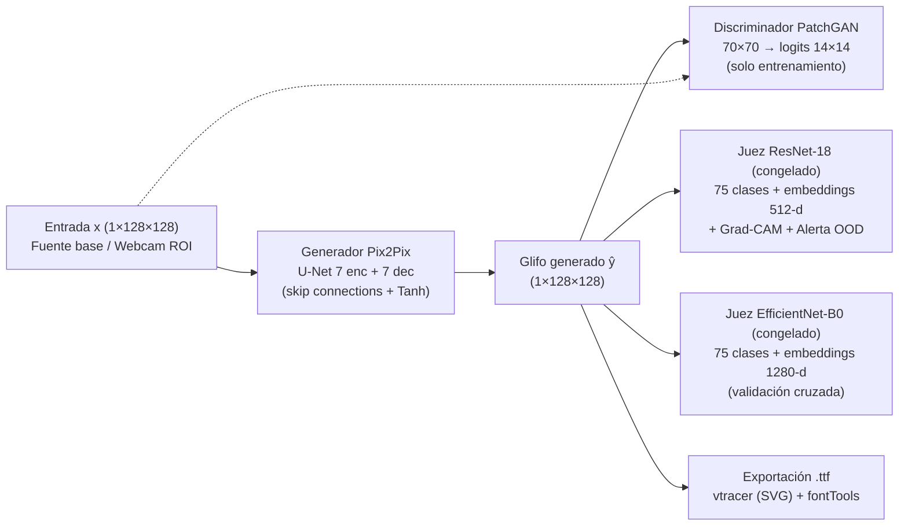

# Handwritten Font cGAN — Generación de Tipografía Manuscrita

Sistema *end-to-end* de traducción imagen-a-imagen condicional (**Pix2Pix: U-Net + PatchGAN**) para sintetizar glifos manuscritos (`1×128×128`), auditar su legibilidad en tiempo real mediante dos clasificadores CNN congelados (`ResNet-18` y `EfficientNet-B0`), ejecutar inferencia en CPU a **19.8 FPS** con **ONNX Runtime** y exportar tipografías instalables en formato **`.ttf`** (`vtracer` + `fontTools`).

---

## 1. Problema y Solución

- **Problema:** Digitalizar escritura manuscrita personal en una tipografía instalable (`.ttf`) suele exigir el trazado vectorial manual de decenas de glifos en software especializado. Por otro lado, los modelos generativos basados en difusión demandan GPUs dedicadas y latencias de segundos por carácter, impidiendo una previsualización interactiva en hardware estándar.
- **Usuario objetivo:** Diseñadores, ilustradores, creadores de contenido y desarrolladores que buscan capturar una muestra compacta de caligrafía (~300 trazos mediante stylus o plantilla), previsualizar glifos en tiempo real por teclado o cámara web y compilar una fuente `.ttf` lista para instalar.
- **Solución técnica:**
  - **Generador condicional (`Pix2Pix`):** U-Net de 7 niveles con *skip connections* + discriminador PatchGAN (`70×70`), preentrenado sobre **3,825 pares sintéticos** de 17 fuentes manuscritas abiertas (*Transfer Learning*) y preparado para *fine-tuning* sobre trazos personales (`--mode finetune`).
  - **Auditoría automatizada y OOD:** Dos redes clasificadoras independientes (`ResNet-18` y `EfficientNet-B0`) congeladas proveen métricas objetivas de legibilidad (**Accuracy, Macro-F1, FID de dominio**), explicabilidad espacial (**Grad-CAM**) y rechazo de entradas fuera de distribución (**OOD**).
  - **Despliegue ligero:** Exportación a **ONNX** (`11.45 ms` por glifo en CPU) acoplada a una demo OpenCV en tiempo real y un pipeline de vectorización hacia `.ttf`.

---

## 2. Conjunto de Datos y Protocolo Anti-Fuga

El diseño completo, licencias y auditoría manual están documentados en [`docs/datasheet.md`](docs/datasheet.md) y explorados en [`notebooks/01_eda_datos.ipynb`](notebooks/01_eda_datos.ipynb):

- **Vocabulario unificado (`src/config.py`):** **75 símbolos** divididos en 4 subgrupos — Mayúsculas (`A–Z`, 26), Minúsculas (`a–z`, 26), Dígitos (`0–9`, 10) y Signos básicos (`.,!?()+-=/:;&`, 13) — en resolución `1×128×128` (escala de grises, fondo blanco `255`, trazo negro `0`, normalizado a `[-1, 1]`).
- **Dataset sintético (`data/synthetic_pairs/`):** **3,825 pares `(x, y)`** generados de forma determinista (`SEED = 42`) emparejando `Lato-Regular` con **17 Google Fonts manuscritas** bajo licencia **SIL Open Font License 1.1 (OFL)**.
- **Captura personal (`data/real_pairs/`):** Pipeline para **300 muestras propias** (75 símbolos × 4 repeticiones) mediante captura guiada con stylus (`src/data/captura_stylus.py` + interfaz web `src/data/stylus_web_ui.py`) o plantilla impresa enderezada por homografía con OpenCV (`src/data/02_extraer_recortes.py`).
- **Benchmark Fuera de Distribución (`data/ood/`):** **72 imágenes** en 6 categorías (ruido puro, garabatos, símbolos inéditos `@ # $ % ñ Ñ ¿ ¡ *`, rotación extrema ±45°, desenfoque/corte y sombra/bajo contraste) para calibración de rechazo OOD.
- **Particiones estrictas sin fuga de información:**
  - **Evaluación Zero-Shot (`test_unseen/`):** 11 símbolos reservados (`G, Q, k, z, 4, 8, ?, &, +, ;, )`) viven exclusivamente en `test_unseen/` (`set(train) ∩ set(test_unseen) == ∅`). Nunca participan en entrenamiento, ajuste de hiperparámetros ni *early stopping*.
  - **Separación por fuente y repetición:** En el dataset sintético se particiona por **fuente tipográfica completa** (`14` fuentes en `train` = 2,688 pares; `3` fuentes inéditas en `val` = 576 pares; `test_unseen` = 561 pares). En capturas reales se separan repeticiones independientes (`192 / 64 / 44`).
  - **Aumentos invariantes a semántica:** Transformaciones afines suaves solo en `train` (`±4°`, `±4 %` traslación, `0.94–1.06` escala); se prohíben explícitamente volteos horizontales/verticales (`b ↔ d`, `p ↔ q`, `6 ↔ 9`).

---

## 3. Arquitectura y Decisiones de Diseño



| Alternativa evaluada | Ventaja teórica | Decisión arquitectónica (`Pix2Pix + Transfer Learning`) |
| :--- | :--- | :--- |
| **Diffusion / ControlNet** | Alta fidelidad en resoluciones altas | Requiere GPU dedicada (>6 GB VRAM) y segundos por glifo (`<1 FPS` en CPU). La U-Net exportada a ONNX corre a **11.45 ms (87.3 FPS)** en CPU y se preentrena en ~14 min sobre Colab T4. |
| **CycleGAN (no emparejado)** | No requiere pares alineados `(x, y)` | Sin alineación píxel a píxel ni pérdida `L1`, tiende a deformar topologías en símbolos no vistos (*Zero-Shot*). Con pares exactos `(Lato, manuscrito)`, las *skip connections* + `L1 (λ=100)` preservan la estructura del carácter. |
| **Entrenamiento *From Scratch* vs. *Pretrain + Fine-Tuning*** | Simplicidad de una sola etapa | Con pocas muestras personales (~192 en `train`), entrenar desde cero memoriza caracteres vistos. El preentrenamiento sintético sobre 3,825 pares transfiere geometría tipográfica general antes de adaptar el estilo propio (`--mode finetune`). |
| **Evaluadores CNN congelados (`ResNet-18` + `EfficientNet-B0`)** | Alternativa: solo L1 o inspección visual | La pérdida L1 premia trazos borrosos. Usar dos arquitecturas CNN independientes congeladas provee métricas de legibilidad (**Accuracy, Macro-F1, FID**), explicabilidad (**Grad-CAM**) y detección **OOD** en tiempo real. |

---

## 4. Resultados y Benchmarks

### 4.1 Evaluación cuantitativa (`eval/evaluate_models.py`)

Métricas del modelo preentrenado sobre fuentes sintéticas (`pix2pix_pretrained.pth`) frente al techo de referencia (`y`). El pipeline incluye además los modos `--mode scratch` y `--mode finetune` en [`src/train/train_pix2pix.py`](src/train/train_pix2pix.py) para adaptación sobre estilo personal (`data/real_pairs/`).

| Split | Modelo / Fuente | Accuracy (`ResNet-18` / `EffNet-B0`) | Macro-F1 (`ResNet-18` / `EffNet-B0`) | L1 media | FID dominio (`ResNet-18`) |
| :--- | :--- | :---: | :---: | :---: | :---: |
| `val` (64 vistas) | Referencia `y` (techo) | 87.67 % / 85.07 % | 87.58 % / 85.30 % | — | 0.00 |
| `val` (64 vistas) | `pix2pix_pretrained` | 71.88 % / 68.75 % | 67.45 % / 64.58 % | 0.1104 | 133.24 |
| `test_unseen` (11 Zero-Shot) | Referencia `y` (techo) | 98.22 % / 97.68 % | 98.99 % / 98.61 % | — | 0.00 |
| `test_unseen` (11 Zero-Shot) | `pix2pix_pretrained` | 45.45 % / 54.55 % | 45.45 % / 50.00 % | 0.0994 | 358.22 |

### 4.2 Rendimiento en tiempo real con ONNX Runtime (`docs/robustez_y_despliegue.md`)

Medido en **CPU Intel (12 núcleos lógicos)**, Windows 10, sin GPU dedicada, Python `3.11.18`, PyTorch `2.15.0+cpu`, ONNX Runtime `1.32.0` (`batch_size = 1`, `1×128×128`, 100 inferencias tras 10 de calentamiento):

| Etapa | PyTorch CPU (ms) | ONNX Runtime CPU (ms) | ONNX FPS | Speedup | Tiempo real (≥10 FPS) |
| :--- | :---: | :---: | :---: | :---: | :---: |
| Generador `G` (`UNetGenerator`) | 27.34 ± 5.73 | **11.45 ± 0.71** | **87.32** | 2.39× | Sí |
| Juez (`ResNet-18`) | 7.30 ± 0.74 | **6.82 ± 8.04** | **146.59** | 1.07× | Sí |
| **Pipeline completo (`G + Juez`)** | 34.56 ± 2.78 | **50.50 ± 25.68** | **19.80** | — | **Sí (≤100 ms)** |

### 4.3 Robustez OOD e Interpretabilidad
- **Detección OOD (`eval/robustez.ipynb`, 72 imágenes en 6 categorías):** `ResNet-18` alcanza **AUROC = 0.9435** en evaluación directa (`94.4 %` rechazo en `τ = 0.85`). En el pipeline de la demo (`G + ResNet-18`, `τ = 0.70`) rechaza **81.9 %** global, con **100 %** en `garabatos` y `simbolos_ineditos` y **91.7 %** en `ruido_puro` y `rotacion_extrema`.
- **Interpretabilidad (`docs/interpretabilidad.md`):** Los mapas Grad-CAM sobre `ResNet-18` y `EfficientNet-B0` obtienen una similitud coseno espacial de **0.9895** entre `Grad-CAM(y)` y `Grad-CAM(ŷ)` en aciertos Zero-Shot (vs. **0.9257** en errores), explicando causalmente los fallos por pérdida de trazos pequeños (`! → l`, `i → l`, `6 → C`).
- **Auditoría por subgrupos (`eval/auditoria_subgrupos.ipynb`):** Desglose de Macro-F1 por `Mayúsculas`, `Minúsculas`, `Dígitos` y `Signos` (brecha de 31.95 pp entre mayúsculas y signos en el modelo multi-fuente, motivando el énfasis en trazos finos durante la personalización).

---

## 5. Instalación y Reproducción

Requisitos: **Python 3.11+** (semilla determinista global `SEED = 42` en `src/config.py` y `src/utils.py`).

```bash
# 1. Clonar el repositorio
git clone https://github.com/carloamezcua/handwritten-font-cgan.git && cd handwritten-font-cgan

# 2. Crear entorno virtual e instalar dependencias
python -m venv .venv && .\.venv\Scripts\Activate.ps1 && pip install -r requirements.txt

# 3. Generar dataset sintético (3,825 pares) y set OOD (72 imágenes)
python -m src.data.03_generar_sinteticos --download-fonts && python -m src.data.04_generar_ood

# 4. Entrenar jueces y Pix2Pix (local o GPU vía notebooks/02_colab_training.ipynb)
python -m src.train.train_judges --model all --pretrained && python -m src.train.train_pix2pix --mode pretrain

# 5. Exportar a ONNX, compilar fuente .ttf y correr evaluación + Grad-CAM
python -m src.export.export_onnx && python -m src.export.build_ttf && python -m eval.evaluate_models && python -m eval.gradcam_analysis
```

> Consulta [`data/README.md`](data/README.md) para detalles sobre la estructura de datos y captura de muestras personales (`python -m src.data.captura_stylus`).

---

## 6. Demo Interactiva en Tiempo Real

```bash
python app/demo_realtime.py
```

**Controles en vivo:**
- `M` / `Tab`: alterna entre **Canvas interactivo** (teclado o trazo libre con mouse) y **Webcam ROI** (captura continua con centrado automático por *bounding box*).
- `F`: activa/desactiva espejo horizontal en modo Webcam.
- `+` / `-`: ajusta en vivo el umbral de confianza OOD (default `0.70`), alternando el indicador visual entre `OK` y `BAJA CONFIANZA (OOD)`.
- `S`: guarda captura de la ventana en `results/demo_capture.png`.
- `Q` / `ESC`: salir limpiamente.

---

## 7. Limitaciones y Uso Ético

Resumen de limitaciones técnicas y salvaguardas (detalle completo en [`MODEL_CARD.md`](MODEL_CARD.md) y [`docs/interpretabilidad.md`](docs/interpretabilidad.md)):

1. **Glifos aislados (`1×128×128`):** Sintetiza caracteres individuales sin modelar ligaduras cursivas continuas ni dinámica de presión entre letras adyacentes.
2. **Sensibilidad en trazos finos y pares ambiguos:** Bajo pérdida `L1` multi-fuente, puntos aislados (`!`, `i`, `:`) y caracteres *sans-serif* similares (`l/I/1`, `0/O/o`) concentran la mayoría de confusiones; el ajuste fino sobre un estilo personal único reduce este efecto.
3. **Generalización *Zero-Shot* parcial:** Símbolos complejos no vistos (`4`, `Q`, `G`, `&`) pueden presentar artefactos; el detector de confianza (`τ = 0.70`) alerta al usuario en tiempo real.
4. **Cobertura base de alfabeto:** Entrenado sobre 75 caracteres ASCII; glifos extendidos del español (`ñ, Ñ, ¿, ¡`) se evalúan como símbolos inéditos en inferencia.
5. **Uso responsable:** Prohibido su uso para suplantación de identidad o falsificación de escritura/firmas sin consentimiento expreso (el exportador `.ttf` incrusta metadatos de origen en la tabla `name` de la fuente).

---

## 8. Documentación Técnica

| Documento | Contenido |
| :--- | :--- |
| [`MODEL_CARD.md`](MODEL_CARD.md) | Alcance del modelo, usos previstos/no previstos, sesgos y mitigaciones |
| [`docs/datasheet.md`](docs/datasheet.md) | Origen de datos, licencias OFL, protocolo anti-fuga y auditoría de calidad |
| [`docs/interpretabilidad.md`](docs/interpretabilidad.md) | Análisis espacial con Grad-CAM y diagnóstico causal de errores |
| [`docs/robustez_y_despliegue.md`](docs/robustez_y_despliegue.md) | Benchmarks PyTorch vs. ONNX Runtime y evaluación de rechazo OOD |
| [`docs/costos.md`](docs/costos.md) | Costos de entrenamiento GPU, inferencia CPU y almacenamiento |
| [`eval/robustez.ipynb`](eval/robustez.ipynb) | Evaluación cuantitativa y visual de 72 imágenes OOD |
| [`eval/auditoria_subgrupos.ipynb`](eval/auditoria_subgrupos.ipynb) | Desempeño desglosado por subgrupo tipográfico (`A–Z`, `a–z`, `0–9`, signos) |
| [`notebooks/01_eda_datos.ipynb`](notebooks/01_eda_datos.ipynb) | Análisis exploratorio de datos, balance de clases e inspección visual |
| [`notebooks/02_colab_training.ipynb`](notebooks/02_colab_training.ipynb) | Flujo de entrenamiento reproducible en GPU (Google Colab) |

---

## 9. Referencias y Créditos

- **Autor:** Carlo A. Amezcua L.
- **Literatura base:**
  - Isola et al. (2017), *"Image-to-Image Translation with Conditional Adversarial Networks"* (CVPR — Pix2Pix).
  - Selvaraju et al. (2017), *"Grad-CAM: Visual Explanations from Deep Networks via Gradient-based Localization"* (ICCV).
- **Fuentes y dependencias:** **Google Fonts** bajo licencia **SIL Open Font License 1.1** (catálogo completo en `data/fonts/licenses.csv`), PyTorch, Torchvision, OpenCV, ONNX Runtime, scikit-learn, SciPy, `vtracer` y `fontTools`.
