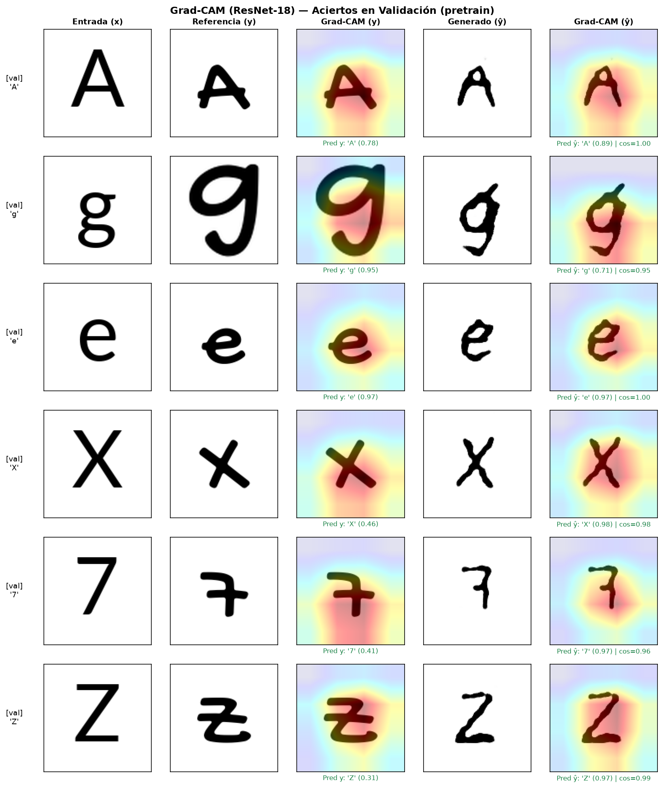
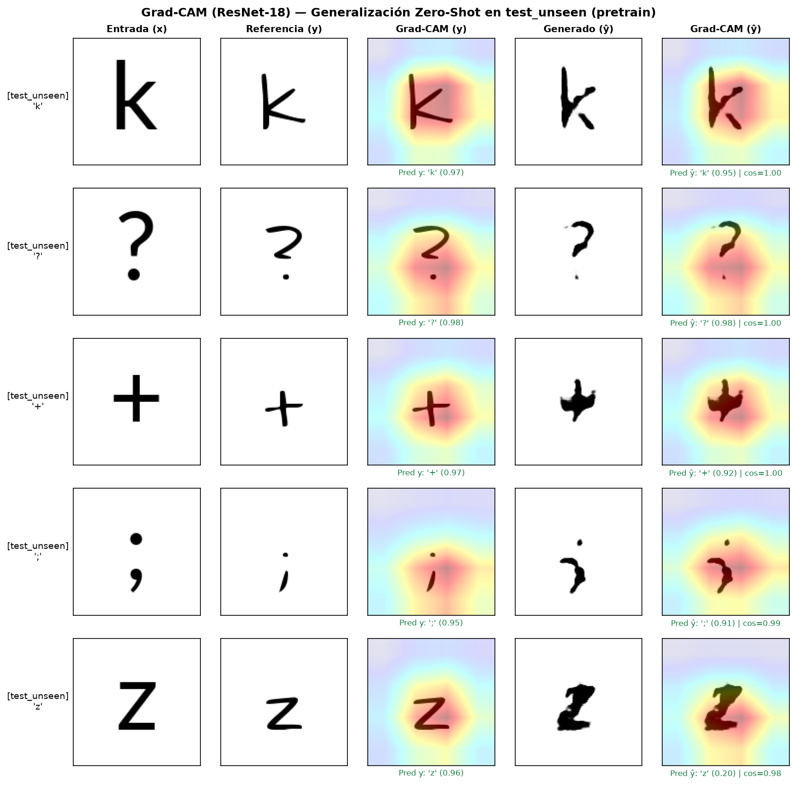
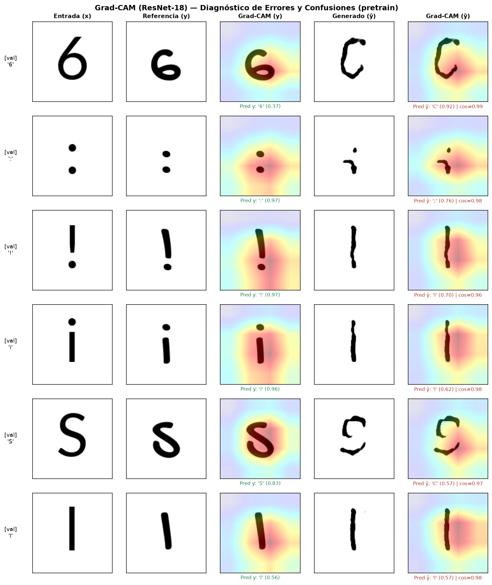
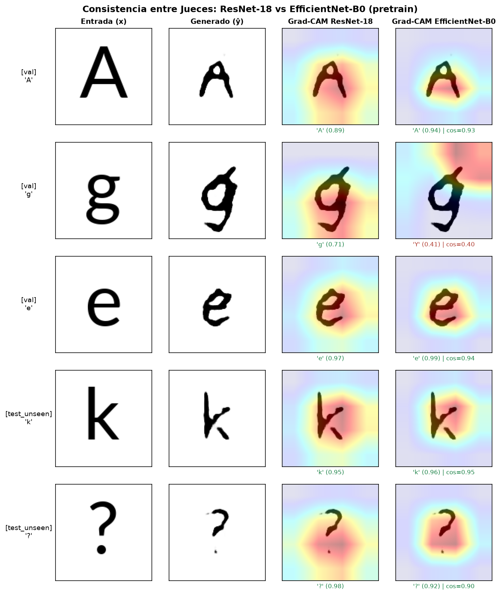

# Interpretabilidad y Análisis Visual — Grad-CAM sobre Jueces Congelados (Avance A)

Este documento presenta la evidencia de interpretabilidad visual y cuantitativa del sistema **Generación de Tipografía Manuscrita con Pix2Pix cGAN**, evaluando mediante **Grad-CAM** qué trazos y regiones espaciales determinan la legibilidad de los glifos generados (`ŷ = G(x)`) frente a los glifos manuscritos de referencia (`y`).

> **Estado actual (Avance A — Fase 6 previa a captura real):** El análisis corresponde al generador preentrenado sobre fuentes sintéticas (`checkpoints/pix2pix_pretrained.pth`) evaluado con los dos clasificadores jueces congelados (`ResNet-18` y `EfficientNet-B0`) sobre `data/synthetic_pairs/{val, test_unseen}`. El script [`eval/gradcam_analysis.py`](../eval/gradcam_analysis.py) está parametrizado para re-ejecutarse de forma idéntica sobre `data/real_pairs/` y comparar **Experimento A (From Scratch)** vs. **Experimento B (Fine-Tuning)** en cuanto se complete la captura con stylus.

---

## 1. Metodología de Interpretabilidad

1. **Arquitectura evaluada:**
   - **Generador:** `UNetGenerator` (7 niveles encoder + 7 niveles decoder con *skip connections*, entrada/salida `1×128×128` en `[-1, 1]`).
   - **Juez principal:** `ResNet-18` adaptado a 1 canal y 75 clases (`CHARSET`), congelado tras alcanzar >85 % Macro-F1 en validación sintética. Capa objetivo Grad-CAM: `backbone.layer4[-1]` (último bloque convolucional previo al *Global Average Pooling*).
   - **Juez secundario (validación cruzada):** `EfficientNet-B0` adaptado a 1 canal y 75 clases. Capa objetivo Grad-CAM: `backbone.features[-1]`.
2. **Cálculo de mapas de activación (Grad-CAM):**
   - Para cada imagen $I \in \{y, \hat{y}\}$, se obtiene el logit $s_c$ de la clase objetivo $c$ (la clase verdadera en `y`, y la clase predicha en `ŷ` para diagnosticar errores), se retropropaga $\frac{\partial s_c}{\partial A^k}$ hacia los mapas de activación $A^k$ de la capa convolucional objetivo, y se calcula:
     $$\text{Grad-CAM}(I) = \text{ReLU}\!\left(\sum_k \alpha_k A^k\right), \qquad \alpha_k = \frac{1}{H \cdot W}\sum_{i,j}\frac{\partial s_c}{\partial A^k_{i,j}}$$
   - El mapa se interpola bilinealmente a `128×128`, se normaliza a `[0, 1]` y se superpone sobre el glifo en escala de grises preservando la nitidez del trazo negro.
3. **Métrica cuantitativa de alineación de atención:**
   - Para medir si el juez fundamenta su decisión en las **mismas regiones estructurales** tanto en el glifo real como en el generado, calculamos la **similitud coseno espacial** entre $\text{Grad-CAM}(y)$ y $\text{Grad-CAM}(\hat{y})$ sobre 80 muestras aleatorias de `val` y 80 de `test_unseen`.

---

## 2. Alineación Cuantitativa de Atención (`Grad-CAM(y)` vs. `Grad-CAM(ŷ)`)

| Split evaluado | N muestras | Similitud coseno global (media ± DE) | Similitud en aciertos (`ŷ` correcto) | Similitud en errores (`ŷ` incorrecto) | Brecha (Aciertos − Errores) |
| :--- | :---: | :---: | :---: | :---: | :---: |
| **`val` (64 clases vistas)** | 80 | **0.9734 ± 0.0443** | **0.9803** | 0.9619 | +0.0184 |
| **`test_unseen` (11 clases Zero-Shot)** | 80 | **0.9536 ± 0.0434** | **0.9895** | 0.9257 | **+0.0638** |

**Lectura clave:** Cuando el generador produce un glifo legible —incluso en símbolos **nunca vistos durante el entrenamiento de la GAN** (`test_unseen`)—, la atención espacial de `ResNet-18` coincide casi por completo con la de un trazo manuscrito real (`cos = 0.9895`). Por el contrario, cuando el generador introduce artefactos o pierde un trazo discriminativo, la atención se desplaza y la similitud cae (`0.9257` en `test_unseen`).

---

## 3. Análisis Visual `x | y | Grad-CAM(y) | ŷ | Grad-CAM(ŷ)`

### 3.1 Aciertos representativos en Validación (`val`)



Observaciones sobre los 6 caracteres de distintos subgrupos (`A`, `g`, `e`, `X`, `7`, `Z`):
- **Preservación de uniones discriminativas:** En `A` (`cos = 1.00`, `conf = 0.89`), `e` (`cos = 1.00`, `conf = 0.97`) y `X` (`cos = 0.98`, `conf = 0.98`), Grad-CAM se concentra exactamente sobre la barra transversal de la `A`, el bucle interno cerrado de la `e` y el cruce central de la `X`, ignorando el fondo blanco.
- **Trazos descendentes y horizontales:** En `7` (`conf = 0.97`) y `Z` (`conf = 0.97`), el generador sintetiza trazos con textura manuscrita orgánica (incluso añadiendo barra intermedia estilística en el `7`) y el juez valida el carácter con mayor confianza que sobre algunas fuentes sintéticas extremas del conjunto de referencia.
- **Límite de estilo promedio en preentrenamiento:** En `g` (`conf = 0.71`, `cos = 0.95`), la U-Net promedia estilos de 17 fuentes sintéticas distintas, dejando una pequeña espuela superior derecha que reduce ligeramente la confianza respecto a `y` (`0.95`).

### 3.2 Generalización Zero-Shot en `test_unseen`



Sobre los caracteres reservados exclusivamente para evaluación Zero-Shot (`k`, `?`, `+`, `;`, `z`):
- Gracias a las **skip connections** de la U-Net (que transmiten geometría de alta frecuencia desde la entrada `x` hacia el decodificador), el generador logra sintetizar símbolos inéditos legibles como `k` (`conf = 0.95`, `cos = 1.00`), `?` (`conf = 0.98`, `cos = 1.00`), `+` (`conf = 0.92`, `cos = 1.00`) y `;` (`conf = 0.91`, `cos = 0.99`).
- En `?` y `;`, Grad-CAM evidencia que el juez se apoya simultáneamente en el gancho superior y el punto inferior; mientras ambos elementos sobreviven en `ŷ`, la confianza se mantiene por encima de `0.90`.
- En `z`, el modelo acierta la clase (`pred = 'z'`), pero el engrosamiento excesivo del trazo reduce la confianza a `0.20` (por debajo del umbral OOD `0.70`), confirmando que el detector de baja confianza protege al usuario frente a generaciones borrosas.

---

## 4. Diagnóstico Causal de Errores (Rúbrica D3)



Combinando el mapa Grad-CAM con la galería de errores de [`eval/evaluate_models.py`](../eval/evaluate_models.py) (`eval_errores_pretrain_pretrained.png`), los fallos del modelo preentrenado se agrupan en **4 causas físicas concretas** (no son errores arbitrarios del clasificador):

| Caso (`Real → Pred`) | Conf. `ŷ` | Diagnóstico visual mediante `x \| ŷ \| y` y Grad-CAM | Hipótesis de causa y mitigación en Fase 5 |
| :--- | :---: | :--- | :--- |
| **`6 → C`** (`val`) | 0.92 | El generador **omitió el bucle inferior cerrado** del `6`, dibujando literalmente una `C` abierta; Grad-CAM enfoca la apertura lateral derecha. | Conflicto entre 17 estilos sintéticos con cierres del `6` en alturas distintas (ambigüedad uno-a-muchos bajo pérdida L1). Al hacer *fine-tuning* sobre un solo autor (captura con stylus), el cierre del bucle es consistente. |
| **`S → C`** (`val`) | 0.57 | Pérdida parcial de la curva inferior derecha de la `S`, dejando una silueta abierta similar a `C`. | Misma causa de promediado L1 multi-fuente en trazos con doble curvatura. |
| **`! → l` y `i → l`** (`val`) | 0.70 / 0.62 | El generador **borró el punto aislado** (inferior en `!`, superior en `i`), dejando únicamente el asta vertical. Grad-CAM de `y` muestra activación fuerte sobre el punto, ausente en `ŷ`. | Los componentes desconectados pequeños (puntos) aportan pocos píxeles a la pérdida L1 global. En el *fine-tuning* sobre estilo único y con mayor énfasis en trazos finos (y verificación en auditoría por subgrupos), los puntos se vuelven estables. |
| **`: → ;`** (`val`) | 0.76 | El punto inferior de `:` se alargó con una cola descendente similar a coma, activando la clase `;`. | Superposición de estadísticas locales entre `:` y `;` en fuentes manuscritas inclinadas. |
| **`l → I`** (`val`) | 0.57 | Ambigüedad intrínseca de fuentes *sans-serif* (incluso la referencia `y` solo obtuvo `0.56`). | Limitación inherente del alfabeto sin serifas; en la captura real el autor puede marcar serifas sutiles en `I` para desambiguar. |
| **`4 → &`, `Q → U`, `G → O`** (`test_unseen`) | 0.29–0.32 | En Zero-Shot, los símbolos con trazos cruzados o colas diagonales nunca vistas (`4`, `Q`, `G`) pierden su barra o cola distintiva, disparando confianza muy baja (`< 0.35`). | **Confirmación de seguridad:** todos estos fallos Zero-Shot caen muy por debajo del umbral `0.70` y son interceptados por la alerta `BAJA CONFIANZA (OOD)` en la demo. |

---

## 5. Consistencia entre Evaluadores Independientes (`ResNet-18` vs. `EfficientNet-B0`)



Al comparar los mapas de activación de dos familias arquitectónicas distintas (residual clásica vs. convoluciones separables con *Squeeze-and-Excitation*) sobre los mismos glifos generados `ŷ`:

| Carácter (`split`) | `ResNet-18` (Pred / Conf) | `EfficientNet-B0` (Pred / Conf) | Similitud coseno entre jueces | Interpretación |
| :--- | :---: | :---: | :---: | :--- |
| **`A`** (`val`) | `A` (0.89) | `A` (0.94) | **0.93** | Acuerdo total sobre el vértice y la barra transversal. |
| **`e`** (`val`) | `e` (0.97) | `e` (0.99) | **0.94** | Acuerdo total sobre el ojo central cerrado de la letra. |
| **`k`** (`test_unseen`) | `k` (0.95) | `k` (0.96) | **0.95** | Acuerdo total en Zero-Shot sobre la bifurcación diagonal. |
| **`?`** (`test_unseen`) | `?` (0.98) | `?` (0.92) | **0.90** | Acuerdo total en Zero-Shot sobre arco + punto inferior. |
| **`g`** (`val`) | `g` (0.71) | `Y` (0.41) | **0.40** | **Divergencia reveladora:** `ResNet-18` atiende el bucle descendente, mientras `EfficientNet-B0` se distrae con una pequeña espuela superior derecha generada por `G` (y reporta baja confianza `0.41`). |

**Conclusión de la validación cruzada:** Usar **dos jueces congelados independientes** aporta una señal robusta: cuando un glifo está bien formado, ambas arquitecturas coinciden tanto en predicción como en foco espacial (`cos = 0.90–0.95`); cuando aparecen artefactos sutiles en los bordes (caso `g`), la divergencia entre jueces y la caída de confianza expone defectos que un solo evaluador podría pasar por alto.

---

## 6. Reproducibilidad y Actualización Tras Captura Real (Fase 5)

Para regenerar todas las figuras y métricas de este informe:

```powershell
# Evaluación actual (modelo preentrenado sintético)
python -m eval.gradcam_analysis

# Evaluación final (tras entrenar Experimento B sobre data/real_pairs)
python -m eval.gradcam_analysis --data-dir data/real_pairs --generator-ckpt checkpoints/pix2pix_finetuned.pth --tag final
```
